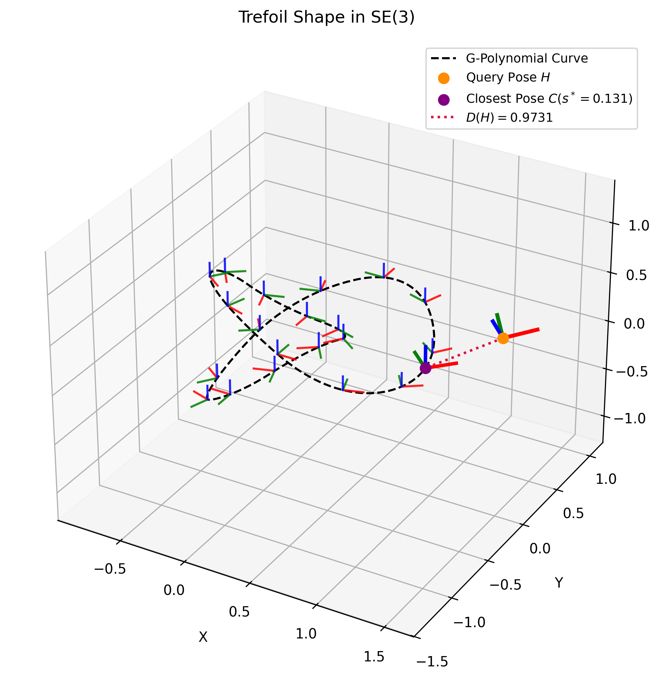

# `se3_efficient_distance`

Accompanying implementation for the paper **"Efficient Computation of Distance Functions for Navigation Vector Fields in Lie Groups"** *(accepted for publication in IEEE Robotics and Automation Letters — awaiting publication)*.

## Overview

This repository provides a C++ library for fast, analytical computation of the distance $D(H)$ and closest point between a query pose $H \in \mathrm{SE}(3)$ and smooth parametric curves on $\mathrm{SE}(3)$ defined via $G$-polynomial interpolation.

## Dependencies

- **C++17** compatible compiler (`g++` or `clang++`)
- **CMake** ($\ge 3.14$)
- **Eigen3** ($\ge 3.3$)
- **Python 3** with `numpy` and `matplotlib` *(optional, required only for generating the example visualization)*

## Building and Running the Example

Clone the repository and build the project using CMake:

```bash
git clone https://github.com/JoBaiao/se3_efficient_distance.git
cd se3_efficient_distance
mkdir -p build && cd build
cmake ..
make -j$(nproc)
```

Run the minimal example from the build directory:

```bash
./minimal_example
```

This executable evaluates the $\mathrm{SE}(3)$ distance from a query pose $H_{\text{query}}$ to a closed test curve (e.g., Trefoil, Lemniscate, Harmonic, or Square) and invokes `examples/plot_example.py` to generate the 3D visualization at `examples/se3_distance_example.png`.



## Citation

If you use this code in your research, please cite the accompanying paper:

```bibtex
@article{goncalves2026efficient,
  title   = {Efficient Computation of Distance Functions for Navigation Vector Fields in Lie Groups},
  author  = {Gon{\c{c}}alves, Vinicius M. and Bai{\~a}o, Jo{\~a}o and Bartelt, Felipe and Macharet, Douglas G. and Freitas, Gustavo and Azp{\'u}rua, H{\'e}ctor Ignacio and Pimenta, Luciano},
  journal = {IEEE Robotics and Automation Letters},
  year    = {2026},
  note    = {Accepted for publication}
}
```